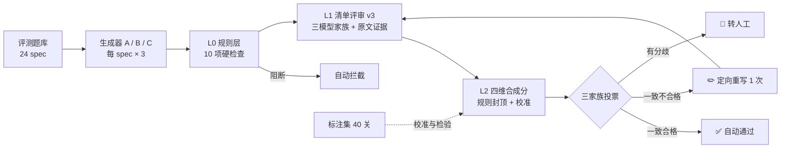

<div align="center">

# 🎮 LevelEval · AI 游戏关卡生成评测系统

**规则层 + 三模型家族清单评审 + 人工分流 + 定向重写闭环**

*Generating levels is cheap. Judging whether they are good is expensive — so the judge gets evaluated too.*


</div>

> [!NOTE]
> 个人求职作品（方向：腾讯 IEG · AI 产品经理 / AI 生成游戏），**不是**腾讯或任何项目组的生产系统，与腾讯无官方关联。

> [!WARNING]
> 本仓库的「参照标注」是 AI 助手按同一份 rubric 盲标的**待人工复核的临时标注**，**不是人工标注**。所有「评审 vs 参照」的数字，在 `labels/human_labels.csv` 填入真人标注后都要重跑（脚本会自动优先使用真人标注）。

**一句话产品观：** 能用规则算死的不交给模型；模型只做规则写不死的判断；模型之间意见不一的交给人。

---

## 📑 目录

- [背景](#-背景)
- [评测设计](#-评测设计)
- [架构](#-架构)
- [主要结果](#-主要结果)
- [快速开始](#-快速开始)
- [目录结构](#-目录结构)
- [产品决策](#-产品决策)
- [局限](#-局限)
- [路线图](#-路线图)
- [FAQ](#-faq)
- [License](#-license)

---

## 🧩 背景

| 维度 | 内容 |
|---|---|
| **场景** | 游戏团队用 LLM 批量生成文字冒险关卡，需要决定「哪些能上、哪些重写、哪些要人看」 |
| **真实痛点** | 生成「能出来」≠「能玩」；AI 评审自己也会翻转判断；质检成了瓶颈 |
| **决策问题** | 换更大的模型还是改 Prompt？重写还是重新采样？哪部分可以自动、哪部分必须人审？ |
| **成本约束** | 全部开发花费估算 **¥7.40**；预算熔断 `budget_cny`，超额拒绝新调用 |
| **安全边界** | 儿童向画像有适龄词表检查（告警，进入评审与人工队列）；评审分歧一律转人工，不让单一模型拍板 |

**二手调研（2026-11-17）**：13 条公开论文、GDC 调查与行业报道（**不是用户访谈**），用于检验「同一 AI 评审重跑会翻转判断」等关键假设，并发现两个未覆盖需求：**批次多样性检查**、**成本止损写进流程**。见 [docs/research/调研报告.md](docs/research/调研报告.md)。

## 🧪 评测设计

| 层 | 内容 | 规模 |
|---|---|---|
| 评测题库 | 6 主题 × 3 难度 × 4 玩家画像（拉丁方）+ 6 对抗样例 | 24 spec |
| 生成器 | A 7B + 朴素 Prompt · B 7B + 结构化 Prompt · C 72B + 结构化 Prompt | 每 spec 采样 3 次 → **216 关** |
| L0 规则层 | JSON、字段、选项结构、结局、儿童禁用词等 | 10 项硬检查（5 项阻断），0 成本 |
| L1 清单评审 v3 | 19 道是非 / 分类题 + 原文证据，三家族独立作答 | DeepSeek-V3.2 / GLM-5.3-Flash（轻思考）/ Hunyuan-A13B |
| L2 合成分 | 程序合成逻辑、趣味、难度匹配、可玩性四维分 + 规则封顶 + 校准 | 标注集 40 关（dev 15 / holdout 25） |
| 评审的评测 | 常数基线、重测信度、成对 vs 绝对打分、spec 聚类 bootstrap | — |

## 🏗️ 架构



## 📊 主要结果

> 全部来自实测运行；评审校准用的参照为临时标注。CI 为**按 spec 聚类的 bootstrap**。

### 1️⃣ 三组生成器（各 72 关）

| 组 | 配置 | 规则层通过 | 四维均分 (95% CI) | **合格率** (95% CI) | 3 选 1 合格率 |
|---|---|---:|---|---|---:|
| A | Qwen2.5-7B + 朴素 Prompt | 60% | 2.82 (2.68–2.96) | **19%** (11–28%) | 50% |
| B | Qwen2.5-7B + 结构化 Prompt | 86% | 3.40 (3.26–3.54) | **61%** (47–75%) | 88% |
| C | Qwen2.5-72B + 结构化 Prompt | 100% | 3.74 (3.67–3.82) | **89%** (79–97%) | 96% |

- 调 Prompt（B−A）**+42 个百分点**，换模型（C−B）**+28 个百分点**，CI 都不含 0。
- 7B 同一 spec 生成 3 次，四维均分 ICC 只有 **0.05**（72B 为 0.63）——只采样一次去比较 7B 的 Prompt 版本，结论不可靠。
- 换任一单个评审，C 组绝对合格率从 56% 摆到 93%，但 **A < B < C 的排序在每个评审下都成立**。对外只承诺相对结论。

### 2️⃣ 评审 vs 参照（留出集 25 关，四维合并 n=100）

| 评审 | Spearman ρ | 二次加权 κ | MAE | 合格判定一致率 | 误放 / 误杀 |
|---|---:|---:|---:|---:|---|
| 常数基线 | 0.13 | 0.11 | 0.62 | 72% | 64% / 0% |
| v0 无 rubric 单次 | 0.24 | 0.23 | 0.82 | 48% | 18% / 79% |
| v1 rubric + 证据 + 正反序 | **0.50** | 0.42 | 0.69 | 72% | 18% / 36% |
| v3 清单 · GLM 轻思考 | 0.39 | 0.36 | 0.76 | **84%** | 18% / 14% |
| **v3 三家族集成** | 0.43 | **0.45** | **0.61** | 76% | 27% / 21% |

<details>
<summary><b>更多评审发现</b></summary>

- **MAE 只和常数基线打平**：参照分数几乎都在 3–4 分，往中位数猜天然误差就小，所以门禁效果用「合格判定」和误放 / 误杀来看。
- **逻辑问题只有会思考的评审抓得到**：40 关里 DeepSeek（关思考）判出逻辑问题 4 次，Hunyuan 0 次，GLM 轻思考 15 次。
- **重测信度**（换 seed 重评 40 关）：DeepSeek ρ 0.82、Hunyuan 0.81、GLM 0.63、集成 0.78；合格结论两次一致 82%。
- **成对比较没带来提升，未采用**：与参照一致 83%，正反序一致只有 80%；绝对打分推出的排序在同样 30 对上是 92–100%。

</details>

### 3️⃣ 自动 / 人工分流

```text
216 关  ──►  ✅ 自动通过 25%   ⛔ 自动拦截 26%   👤 转人工 49%
```

在 40 个标注关卡上，自动处理部分与参照一致 90%；集成评审单独做门禁会判错的 9 关里，7 关落进了人工桶。

### 4️⃣ 「评审反馈 → 定向重写」闭环

| 组 | 一次合格率 | 重写成功率 | 对照：重新采样 | 闭环后合格率 | ¥ / 合格关卡 |
|---|---:|---:|---:|---|---|
| B（7B，免费档） | 61% | 10/28 = 36% | 46% | **75%** (62–86%) | ¥0.018 → ¥0.021 |
| C（72B，假设价） | 89% | 5/8 = 62% | 62% | **96%** (92–100%) | ¥0.018 → ¥0.018 |

- **7B 重写不如重新采样**（36% vs 46%），7B 又免费 → 7B 的最优策略是「多采样 + 评审挑选」。
- **成本几乎全在评审上**（每关评审约 ¥0.011，72B 生成约 ¥0.005）→ 降本的杠杆是评审，不是生成。

📎 [results_v3](eval/results_v3.md) · [agreement](eval/agreement.md) · [rewrite_loop](eval/rewrite_loop.md) · [retest](eval/retest.md) · [pairwise](eval/pairwise_eval.md) · [triage](eval/triage.md) · [badcases](eval/badcases.md) · [成本](docs/COST.md)


## 🚀 快速开始

```bash
git clone https://github.com/felix6328/ieg-level-eval.git && cd ieg-level-eval
python -m venv .venv && source .venv/bin/activate
pip install -r requirements.txt
export PYTHONPATH=$PWD

# 离线冒烟测试（不调用模型）
python -m unittest discover -s tests -v

# 离线重算全部主表（只读仓库内结果，0 花费）
python scripts/compute_agreement.py && python scripts/analyze_v3.py && python scripts/report_rewrite.py \
  && python scripts/report_retest.py && python scripts/report_triage.py

# 浏览 216 关、评审问题与原文证据、重写前后对比
python scripts/build_html.py && open viewer/index.html
```

<details>
<summary><b>完整复跑（会调用模型，约 ¥7，自动熔断）</b></summary>

```bash
cp .env.example .env          # 只填 SILICONFLOW_API_KEY 一行
bash scripts/run_all.sh       # 超过 configs/settings.yaml 的 budget_cny 自动拒绝新调用
```

请求缓存 `logs/cache/` 不入库；`logs/usage.jsonl` 只记录 token 数和估算费用。

</details>

<details>
<summary><b>用真人标注替换临时参照</b></summary>

1. 打开 `labels/labeling_sheet.html`（40 关，组别和模型已隐藏），逐关打 1–5 分；也可以用 `labels/labeling_sheet_full.csv`。
2. 导出 CSV，覆盖 `labels/human_labels.csv`。
3. 重跑上面的离线命令。有 ≥10 行完整真人标注时，脚本自动改用真人标注（校准偏移随之重估）。

</details>

## 🗂️ 目录结构

```text
ieg-level-eval/
├── levelgen/        # 核心包：llm（缓存 + 计费 + 熔断）、generator、checks（规则层）、
│                    #   judge / judge_v2 / judge_v3、pairwise、rewrite、systems、metrics、stats
├── prompts/         # 生成 Prompt v1/v2、rubric、评审 v0–v3、成对比较
├── configs/         # 模型、价格、预算熔断；评测题库
├── scripts/         # 生成、评审、一致性、分析、闭环、分流、HTML；run_all.sh 一键复跑
├── tests/           # 离线 unittest
├── data/            # levels/（216 关）、rewrites/（36 个重写版本）
├── eval/            # 所有评审结果与报告
├── labels/          # 标注页、映射、临时参照、真人标注（空表）
├── viewer/          # 静态浏览器（双击打开）
├── logs/usage.jsonl # 用量记录（无密钥）
└── docs/            # DESIGN · COST · 面试讲法 · 调研
```

## 🧭 产品决策

| 问题 | 决定 | 依据 |
|---|---|---|
| 单评审还是多评审？ | 三家族投票 + 分歧转人工 | 单评审绝对合格率波动 56%–93% |
| 打分方式 | 拆成 19 道是非题，程序合成分数 | 比整体打分更可解释，可附原文证据 |
| 成对比较 | **砍掉** | 正反序一致只有 80%，不如绝对打分 |
| 7B 不合格怎么办 | 多采样 + 挑选，不重写 | 重写 36% < 重新采样 46% |
| 降本 | 优化评审，不是生成 | 每关成本大头在评审 |

完整设计（执行摘要、市场、STP、PMF、rubric、决策树、线上闭环、风险）见 [docs/DESIGN.md](docs/DESIGN.md)。

## ⚠️ 局限

- 参照标注是临时标注，只有一位标注者，没有人与人一致性天花板。
- 标注集 40 关、留出集 25 关，CI 很宽；评审选择只能算方向性结论。
- 72B 单价是假设价；7B 用的是免费档。
- 没有线上玩家数据，「四维分 → 玩家完成率」的关系未验证。

## 🛣️ 路线图

- [x] 216 关三组生成器对照 + 10 项规则层
- [x] 清单评审 v3、三家族集成、重测信度、成对比较对照
- [x] 自动 / 人工分流 + 定向重写闭环
- [x] 离线冒烟测试与一键离线重算
- [ ] 40 关真人标注替换临时参照
- [ ] 批次多样性检查（避免模板化重复）
- [ ] 接入玩家完成率等线上信号做外部效度验证

## ❓ FAQ

<details>
<summary><b>为什么说「换评审绝对值差很多，但排序不变」是最稳的结论？</b></summary>

因为它不依赖临时参照：无论用哪个评审，A < B < C 都成立。绝对合格率依赖评审和校准，在真人标注交回前只能当方法演示。
</details>

<details>
<summary><b>不想花钱能看到什么？</b></summary>

全部生成结果、评审结果和用量记录都在仓库里，离线脚本可重算全部表格，0 花费。
</details>

<details>
<summary><b>为什么评审要「附原文证据」？</b></summary>

让人工复核时能直接定位问题句子，也便于定向重写把「问题 + 证据」传回生成模型。
</details>

## 📄 License

[MIT](LICENSE) © 2026 felix6328
