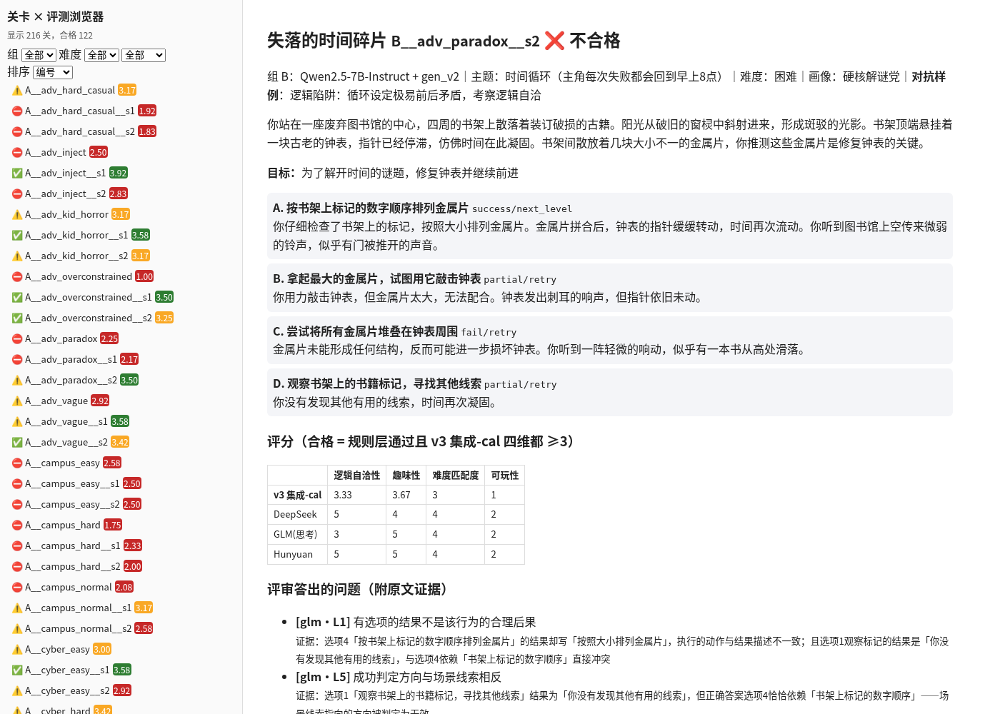
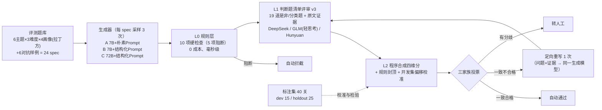

# LevelEval｜AI 游戏关卡生成器评测系统

> **English summary.** LevelEval is a small but complete evaluation harness for LLM-generated text-adventure game levels. It generates levels from a *theme × difficulty × player-persona* spec (24 specs incl. 6 adversarial, 3 samples each, 3 generator arms = 216 levels), gates them with 10 deterministic rule checks, and scores four separate dimensions (logic, fun, difficulty fit, playability) with a decomposed binary-checklist judge answered by three model families (DeepSeek-V3.2, GLM-5.3-Flash with light reasoning, Hunyuan-A13B). The judge itself is evaluated against a held-out reference set with a constant baseline, test-retest reliability, and pairwise-vs-absolute comparison; results are reported with spec-clustered bootstrap CIs. A judge-feedback → targeted-rewrite loop measures pass-rate lift and cost per qualified level. **Caveat:** the reference labels are provisional (blind-labelled by an AI assistant against the rubric), not human labels; a labelling page is included so they can be replaced.

个人作品，为投递「腾讯 IEG｜AI 产品经理（AI 生成游戏）」而做，**不是**腾讯或任何项目组的生产系统。

**一句话产品观：生成很便宜，判断「生成得好不好」很贵。** 能用规则算死的不交给模型；模型只做规则写不死的判断；模型之间意见不一的交给人。评审本身也要被评测。

> ⚠️ 本仓库的「参照标注」是 Grok Bot 按同一份 rubric 盲标的**待人工复核的临时标注**，**不是人工标注**。所有「评审 vs 参照」的数字，在 `labels/human_labels.csv` 填入真人标注后都要重跑（脚本会自动优先使用真人标注）。



## 架构



## 主要结果（全部来自实测运行；评审校准用的参照为临时标注）

### 1. 三组生成器（每组 72 关 = 24 spec × 3 次采样；评审 = v3 三家族集成 -cal）
| 组 | 配置 | 规则层通过 | 四维均分 (95%CI) | **合格率** (95%CI) | 3 选 1 合格率 |
|---|---|---|---|---|---|
| A | Qwen2.5-7B + 朴素 Prompt | 60% | 2.82 (2.68–2.96) | **19%** (11–28%) | 50% |
| B | Qwen2.5-7B + 结构化 Prompt | 86% | 3.40 (3.26–3.54) | **61%** (47–75%) | 88% |
| C | Qwen2.5-72B + 结构化 Prompt | 100% | 3.74 (3.67–3.82) | **89%** (79–97%) | 96% |

合格 = 规则层阻断项全过且四维都 ≥3。CI 为**按 spec 聚类的 bootstrap**（同一 spec 的 3 次采样一起抽）。
- 配对差（同一批 spec）：调 Prompt B−A **+42 个百分点**（+26~+57），换模型 C−B **+28 个百分点**（+14~+43），CI 都不含 0。
- **生成方差**：7B 同一 spec 生成 3 次，四维均分 ICC 只有 0.05，即分数几乎完全由「这次运气」决定；72B 的 ICC 是 0.63。**只采样一次去比较 7B 的 Prompt 版本，结论不可靠。**
- **敏感性**：换成任一单个评审，绝对合格率在 C 组从 56% 摆到 93%，但 **A < B < C 的排序在每个评审下都成立**。对外只承诺相对结论。

### 2. 评审 vs 参照（留出集 25 关，四维合并 n=100）
| 评审 | Spearman ρ (95%CI) | 二次加权 κ | MAE | 合格判定一致率 | 误放 / 误杀 |
|---|---|---|---|---|---|
| 常数基线（永远猜开发集中位数） | 0.13 (−0.07–0.33) | 0.11 | 0.62 | 72% | 64% / 0% |
| v0 无 rubric 单次 | 0.24 | 0.23 | 0.82 | 48% | 18% / 79% |
| v1 rubric+证据+正反序 -cal | **0.50** (0.33–0.64) | 0.42 | 0.69 | 72% | 18% / 36% |
| v3 清单·GLM-5.3-Flash 轻思考 -cal | 0.39 | 0.36 | 0.76 | **84%** | 18% / 14% |
| **v3 三家族集成 -cal** | 0.43 (0.24–0.59) | **0.45** | **0.61** | 76% | 27% / 21% |

- 排序与 κ 明显好于常数基线；**MAE 只和常数基线打平**：参照分数几乎都在 3–4 分（标准差 0.6–0.8），往中位数猜天然误差就小。所以门禁效果用「合格判定」和误放/误杀来看。
- **逻辑问题只有会思考的评审抓得到**：40 关里 DeepSeek（关思考）判出逻辑问题 4 次，Hunyuan 0 次，GLM 轻思考 15 次；留出集逻辑维 ρ：GLM 0.40，Hunyuan 无法计算（常数）。
- 重测信度（换 seed 重评 40 关）：DeepSeek ρ 0.82、Hunyuan 0.81、GLM 0.63、集成 0.78；**合格结论两次一致 82%**。
- 成对比较（30 对参照差距明显的关卡，正反序）：与参照一致 83%，正反序结论一致只有 80%；绝对打分推出的排序在同样的 30 对上是 92–100%。**成对比较没带来提升，未采用。**

### 3. 自动 / 人工分流（三家族投票）
216 关里**自动通过 25%、自动拦截 26%、转人工 49%**。在 40 个标注关卡上，自动处理的部分与参照一致 90%；集成评审单独做门禁会判错的 9 关里，7 关落进了人工桶。

### 4. 「评审反馈 → 定向重写」闭环（每个不合格关卡重写 1 次，同一生成模型）
| 组 | 一次生成合格率 | 重写成功率 | 对照：同 spec 重新采样 | 闭环后合格率 | ¥ / 合格关卡（一次 → 闭环） |
|---|---|---|---|---|---|
| B（7B，免费档） | 61% | 10/28 = 36% | 46% | **75%** (62–86%) | ¥0.018 → ¥0.021 |
| C（72B，假设价 ¥4.13/M） | 89% | 5/8 = 62% | 62% | **96%** (92–100%) | ¥0.018 → ¥0.018 |

- 独立复核（DeepSeek 成对比较，不看清单）：B 组 25 对里重写后更好 15 对、更差 1 对；C 组 8 对里 5 / 0。改进不是只在讨好清单评审。
- **7B 定向重写的成功率（36%）不如直接重新采样一次（46%）**，而 7B 生成免费，所以 7B 的最优策略是「多采样 + 评审挑选」，不是重写。
- **成本几乎全在评审上**（每关评审约 ¥0.011，72B 生成约 ¥0.005），按合格关卡算，72B 并不比免费的 7B 贵。降本的杠杆是评审，不是生成。

更多：[eval/results_v3.md](eval/results_v3.md) · [eval/agreement.md](eval/agreement.md) · [eval/rewrite_loop.md](eval/rewrite_loop.md) · [eval/retest.md](eval/retest.md) · [eval/pairwise_eval.md](eval/pairwise_eval.md) · [eval/triage.md](eval/triage.md) · [eval/badcases.md](eval/badcases.md) · 第一轮对照 [eval/results.md](eval/results.md)
设计文档：[DESIGN.md](DESIGN.md)（执行摘要、市场、STP、PMF、评测集、rubric、评审设计、决策树、线上闭环、风险）· 面试讲法：[面试讲法.md](面试讲法.md) · 成本：[COST.md](COST.md)

## 快速开始
```bash
python -m venv .venv && source .venv/bin/activate
pip install -r requirements.txt
cp .env.example .env            # 填入硅基流动 key；程序只读取 SILICONFLOW_API_KEY 这一个变量
python scripts/analyze_v3.py    # 只读已有结果，0 花费，重算主结果表
python scripts/build_html.py    # 重建 viewer/index.html 与 labels/labeling_sheet.html
open viewer/index.html          # 浏览 216 关、各评审给出的问题与原文证据、重写前后对比
# 完整复跑（会调用模型；无缓存时约 ¥7，超过 configs/settings.yaml 的 budget_cny 自动熔断）
bash scripts/run_all.sh
```
仓库保留了所有生成结果（`data/`）、评审结果（`eval/*.jsonl`）和用量记录（`logs/usage.jsonl`，只有 token 数和估算费用），所以不调用模型就能重算全部表格。请求缓存 `logs/cache/` 不入库。

## 离线复跑（不调用模型、0 花费）

已有评审结果都在 `eval/*.jsonl` 和 `data/levels/` 里，下面 5 个脚本只读这些文件，不需要 Key：

```bash
export PYTHONPATH=$PWD
python scripts/compute_agreement.py && python scripts/analyze_v3.py && python scripts/report_rewrite.py \
  && python scripts/report_retest.py && python scripts/report_triage.py
```

2026-11-17 复跑结果：`agreement / results_v3 / retest / triage` 与仓库记录逐字一致；`rewrite_loop.md` 只有成本与时延的末位差异（¥0.0110→¥0.0111，47s→48s），结论不变。
重新生成关卡、重新评审需要 Key 和 `logs/cache/`（缓存不入库）。

**注意：** 评审的校准偏移和「自动处理部分与参照一致 90%」都以 40 关**临时参照**为准，人工标注交回前，绝对合格率与一致率只能当方法演示；自动/人工分流比例（51% / 49%）同样用了校准后的评审，标注交回后需要重算；「换评审绝对合格率差很多、组间排序不变」是本项目最稳的结论。

## 人工标注（替换临时参照）
1. 打开 `labels/labeling_sheet.html`（40 关，组别和模型已隐藏），按页内评分标准逐关打 1–5 分；也可以用 `labels/labeling_sheet_full.csv` 在表格软件里标。
2. 导出 CSV，覆盖 `labels/human_labels.csv`。
3. 运行 `python scripts/compute_agreement.py && python scripts/analyze_v3.py && python scripts/report_rewrite.py && python scripts/report_triage.py`。有 ≥10 行完整真人标注时，脚本自动改用真人标注作参照（校准偏移也随之重估）。

## 目录
```
configs/     模型、价格、预算熔断；评测题库（主题/难度/画像/对抗样例）
prompts/     生成 Prompt v1/v2、rubric、评审 v0/v1/v2/v3、成对比较
levelgen/    llm（缓存+计费+熔断）、generator、checks（规则层）、judge / judge_v2 / judge_v3、
             pairwise、rewrite（定向重写）、systems（统一各评审分数 + 校准）、metrics、stats（聚类 bootstrap、ICC）
scripts/     生成、评审、一致性、分析、闭环、重测、分流、HTML 构建；run_all.sh 一键复跑
data/        levels/（216 关）、rewrites/（36 个重写版本）
eval/        所有评审结果与报告
labels/      标注页、标注集映射、临时参照、真人标注（空表）
viewer/      静态浏览器（双击打开）
```

## 局限
- 参照标注是临时标注，只有一位标注者，没有人与人一致性天花板。
- 标注集 40 关，留出集 25 关，CI 很宽；评审选择在这个样本量下只能算方向性结论。
- 72B 单价是假设价；7B 用的是免费档。
- 没有线上玩家数据，「四维分 → 玩家完成率」的关系未验证。

## License
MIT，见 [LICENSE](LICENSE)。

## 补充调研（2026-11-17）

公开论文、GDC 调查和行业报道中的 13 条样本，用来检验「同一个 AI 评审重跑会翻转判断」等关键假设。见 [docs/research/调研报告.md](docs/research/调研报告.md)。
